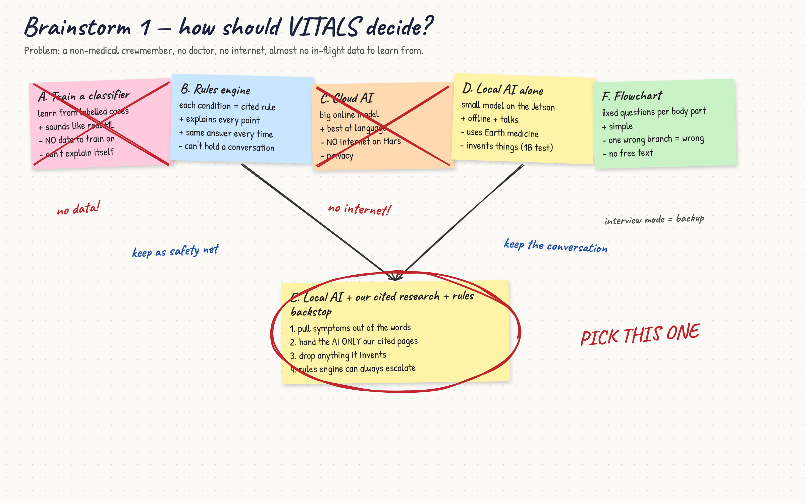

# Brainstorming 1 — how should the system decide?

**Question:** what kind of "brain" can give a non-medical crewmember a trustworthy answer, offline,
with almost no in-flight data to learn from?

These are the approaches the project actually considered. Each one left a trace in the code or the
git history, noted on the right.

| # | Idea | How it would work | Strengths | Weaknesses | What happened |
|---|---|---|---|---|---|
| A | **Train a classifier** (ML on symptom data) | Collect labelled cases, train a model, predict a condition | What "ML" sounds like; fast once trained | **No training data** — several conditions have zero in-flight cases (C4). Can't explain itself. Terrestrial datasets (MIMIC etc.) teach Earth medicine | Rejected after Research 1 |
| B | **Rules / weighted-evidence engine** | Each condition is a cited rule; findings add or subtract evidence; rank by score | Explainable line by line; deterministic; runs anywhere | Weights had to be estimated; brittle with odd phrasing; can't converse | Built first (Aug, "MDX"). Kept as the **cross-check and escalation backstop** — `engine.py` |
| C | **Cloud LLM** (e.g. a hosted model) | Send the complaint to a large model online | Best language understanding | **Fails C1** — no internet on Mars. Privacy (C5) | A `claude` extractor backend exists for development only; never the answer path |
| D | **Local LLM alone** | Small model on the Jetson answers directly | Offline; conversational | Answers from generic *Earth* medicine; invents conditions, citations, symptoms (seen with the 1B model) | Tested; not trusted alone |
| E | **Local LLM grounded in the knowledge base** | Extract findings → retrieve the relevant cited KB pages → the local model reasons over *those pages only* → code checks the reply | Conversational **and** space-specific **and** checkable | Slower than rules; still needs a backstop for safety | **Chosen** (26 Sep) — see decision matrix |
| F | **Decision tree / flowchart** | Fixed question sequence per body area | Simple, predictable | Long interviews; one wrong branch = wrong answer; no free text | The `vitals interview` command keeps a guided mode |

## The board

Ideas that came out of this round and were kept:
- The model **can only name conditions we handed it** (dropped and reported if it invents one).
- The model **never writes a citation** — it returns an id, we look up the source.
- **Temperature 0** so the same complaint always gives the same answer (otherwise untestable).
- **Safety is a separate channel:** if the rules engine escalates, the answer escalates, no matter
  what the model said.
