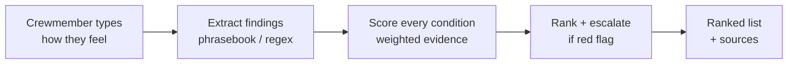
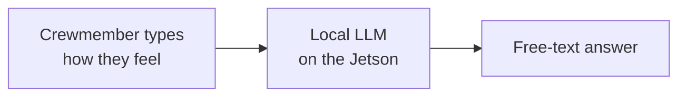
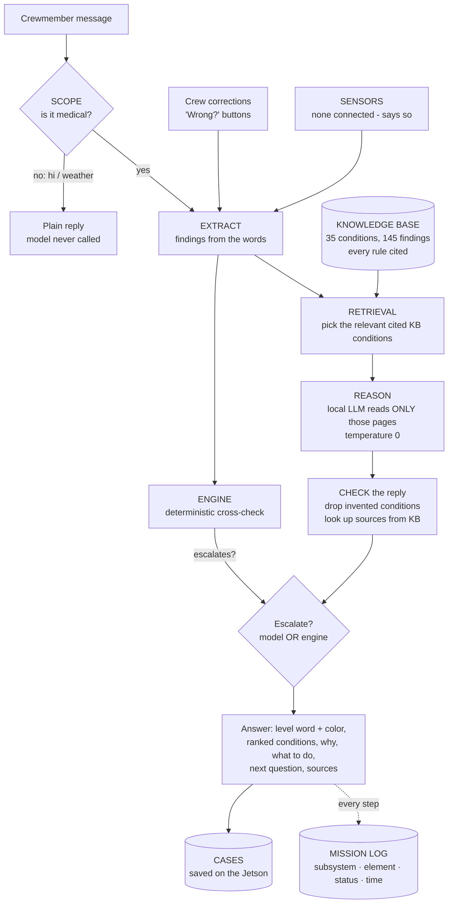
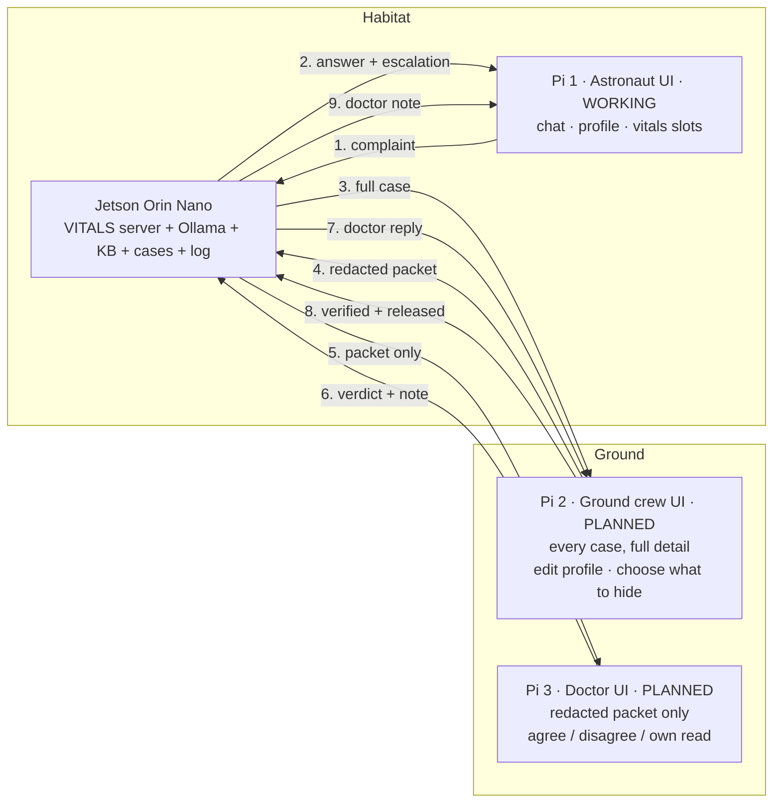

# Functional diagrams — the three best options

The three strongest ideas from Brainstorming 1, drawn the same way so they can be compared.
(GitHub renders these diagrams; for the board, screenshot them or redraw in Figma.)

## Option B — rules engine only

Explainable and instant, but it can't hold a conversation, and every unusual phrasing it can't
read is a miss.

## Option D — local language model only

Conversational and offline — and nothing stops it answering from Earth medicine, naming a
condition we never researched, or writing a citation that doesn't exist.

## Option E — grounded LLM with a rules backstop ✅ chosen

Each box is a **subsystem** in the mission log, and a file in `src/vitals/`:

| Subsystem | File | Job |
|---|---|---|
| SCOPE | `scope.py` | Not medical → plain reply, model never runs |
| EXTRACT | `extract.py`, `patterns.py` | Words → findings (offline phrasebook) |
| SENSORS | `sensors.py` | Measured vitals — currently none, and it says so |
| KB | `knowledge_base.py`, `kb/` | Load + schema-validate the cited rules |
| RETRIEVAL | `retrieval.py` | Choose which KB pages the model may read |
| REASON | `reason.py`, `ollama_client.py` | The local model answers; reply is validated |
| ENGINE | `engine.py`, `scoring.py` | Deterministic cross-check + escalation backstop |
| CASES | `cases.py` | Saves every answer as a case (redaction + doctor review loop: planned) |
| ACCOUNTS | `accounts.py` | PINs, roles, sessions |
| SERVER | `server.py` | HTTP shell — owns no medical logic |

## System / deployment diagram (info flow between the three screens) — planned

Today the Jetson and the astronaut screen (Pi 1) work; Pi 2 and Pi 3 are the plan.

Planned rule: redaction happens **on the Jetson**, not in the browser, so a hidden field never leaves
the server and can't reach the doctor's Pi.

The three-screen flow is a **proof of concept** of how a delayed doctor review would work — the Pis
are on one local network here, not a real 20-minute link.
